<p align="center">
  
</p>

<h1 align="center">Clink themes — unofficial</h1>

<p align="center">Unofficial keyboard themes for Clink.</p>

Themes change the keyboard's colours, materials, type treatment, and gradients. They are ordinary JSON data, so you can read every setting before publishing a theme.

## Official Clink repositories

[Language packs](https://github.com/anti-ltd/clink-language-packs) · [Layouts](https://github.com/anti-ltd/clink-layouts) · [Profiles](https://github.com/anti-ltd/clink-profiles) · [Themes](https://github.com/anti-ltd/clink-themes) · [Panels](https://github.com/anti-ltd/clink-panels) · [Actions](https://github.com/anti-ltd/clink-actions) · [Fonts](https://github.com/anti-ltd/clink-fonts) · [Sounds](https://github.com/anti-ltd/clink-sounds)

<!-- theme-gallery:start -->
## Included themes

60 unofficial themes, with light and dark versions shown together. Select a name to open its theme file, or a preview to see it at full size. These themes are inspired by the named brands and are not affiliated with or endorsed by them.

| Light | Dark |
| --- | --- |
| <a href="Themes/8bitdo-light.clinktheme"><strong>8BitDo Light</strong></a><br><a href="README-assets/previews/8bitdo-light.png">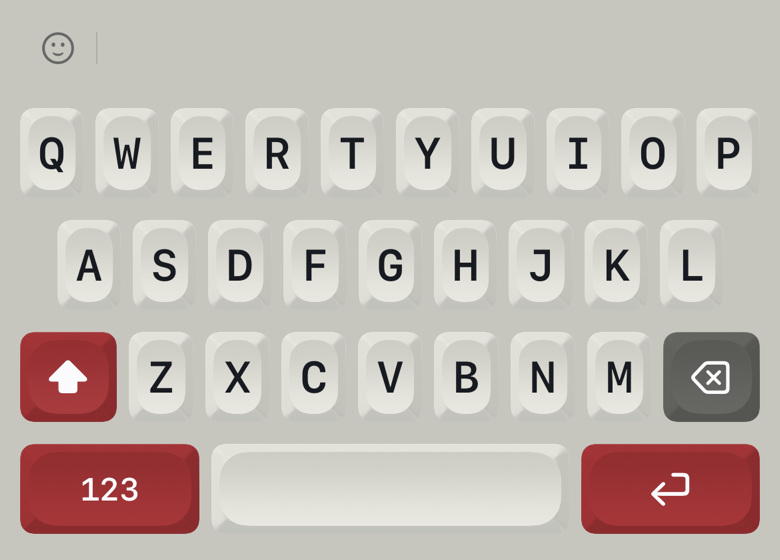</a> | <a href="Themes/8bitdo-dark.clinktheme"><strong>8BitDo Dark</strong></a><br><a href="README-assets/previews/8bitdo-dark.png">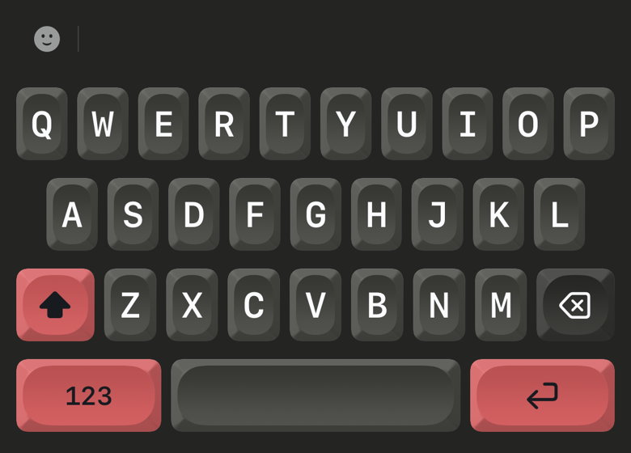</a> |
| <a href="Themes/akko-light.clinktheme"><strong>Akko Light</strong></a><br><a href="README-assets/previews/akko-light.png">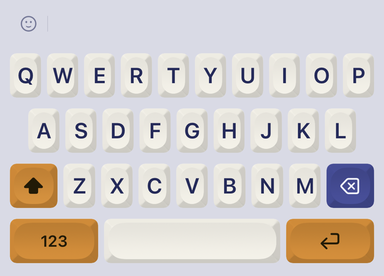</a> | <a href="Themes/akko-dark.clinktheme"><strong>Akko Dark</strong></a><br><a href="README-assets/previews/akko-dark.png">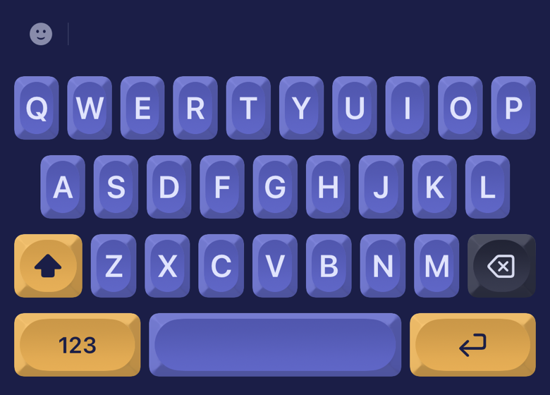</a> |
| <a href="Themes/angry-miao-light.clinktheme"><strong>Angry Miao Light</strong></a><br><a href="README-assets/previews/angry-miao-light.png">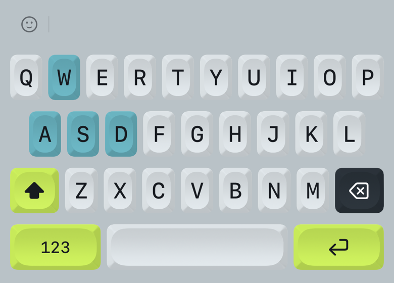</a> | <a href="Themes/angry-miao-dark.clinktheme"><strong>Angry Miao Dark</strong></a><br><a href="README-assets/previews/angry-miao-dark.png">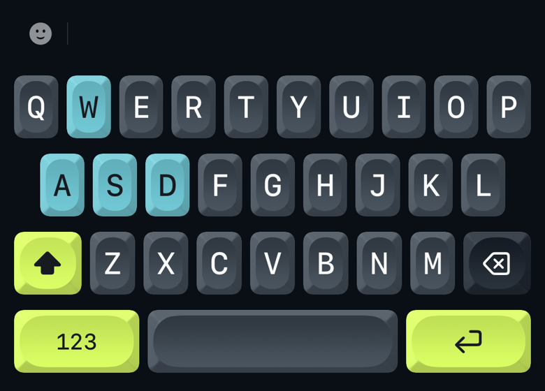</a> |
| <a href="Themes/apple-light.clinktheme"><strong>Apple Light</strong></a><br><a href="README-assets/previews/apple-light.png">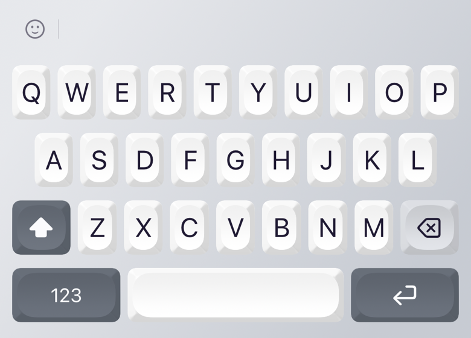</a> | <a href="Themes/apple-dark.clinktheme"><strong>Apple Dark</strong></a><br><a href="README-assets/previews/apple-dark.png">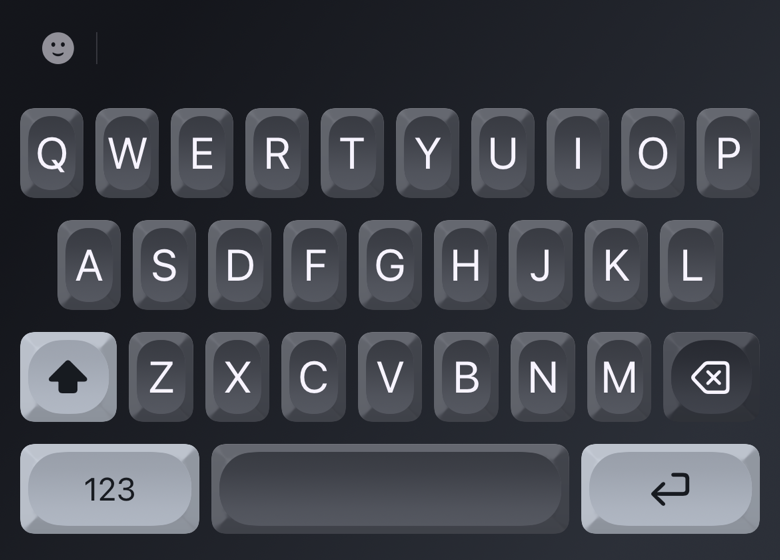</a> |
| <a href="Themes/cooler-master-light.clinktheme"><strong>Cooler Master Light</strong></a><br><a href="README-assets/previews/cooler-master-light.png">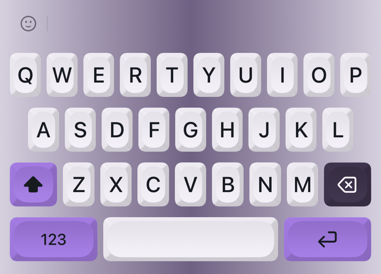</a> | <a href="Themes/cooler-master-dark.clinktheme"><strong>Cooler Master Dark</strong></a><br><a href="README-assets/previews/cooler-master-dark.png">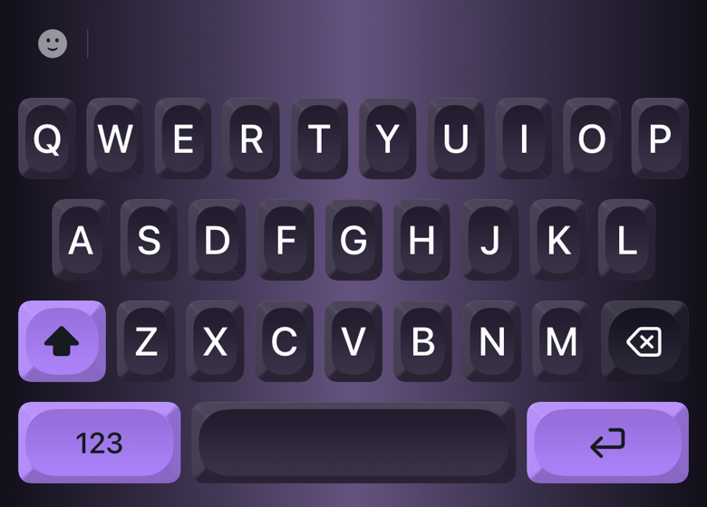</a> |
| <a href="Themes/corsair-light.clinktheme"><strong>Corsair Light</strong></a><br><a href="README-assets/previews/corsair-light.png">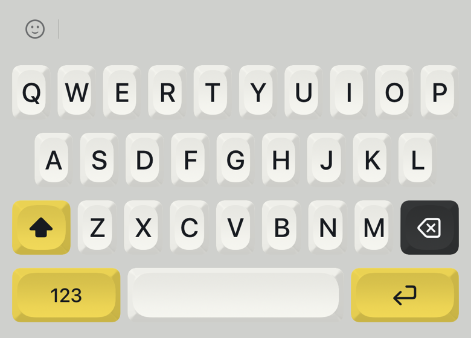</a> | <a href="Themes/corsair-dark.clinktheme"><strong>Corsair Dark</strong></a><br><a href="README-assets/previews/corsair-dark.png">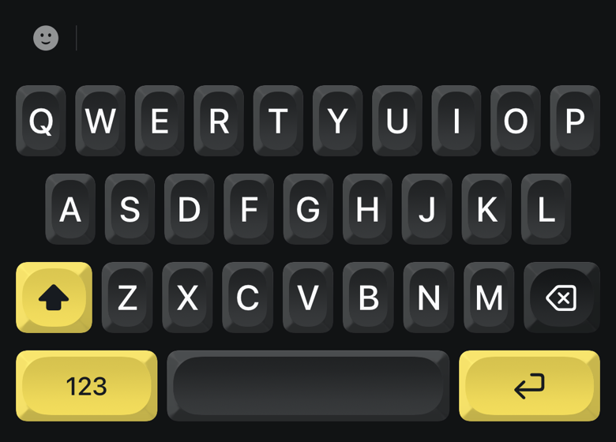</a> |
| <a href="Themes/drop-light.clinktheme"><strong>Drop Light</strong></a><br><a href="README-assets/previews/drop-light.png">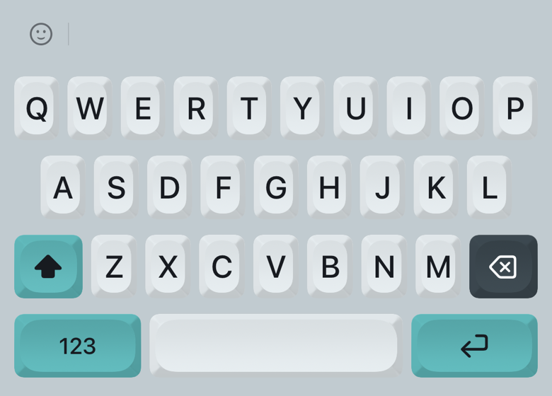</a> | <a href="Themes/drop-dark.clinktheme"><strong>Drop Dark</strong></a><br><a href="README-assets/previews/drop-dark.png"></a> |
| <a href="Themes/ducky-light.clinktheme"><strong>Ducky Light</strong></a><br><a href="README-assets/previews/ducky-light.png">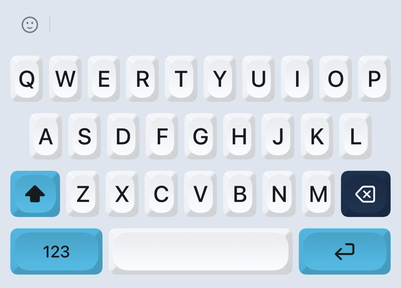</a> | <a href="Themes/ducky-dark.clinktheme"><strong>Ducky Dark</strong></a><br><a href="README-assets/previews/ducky-dark.png">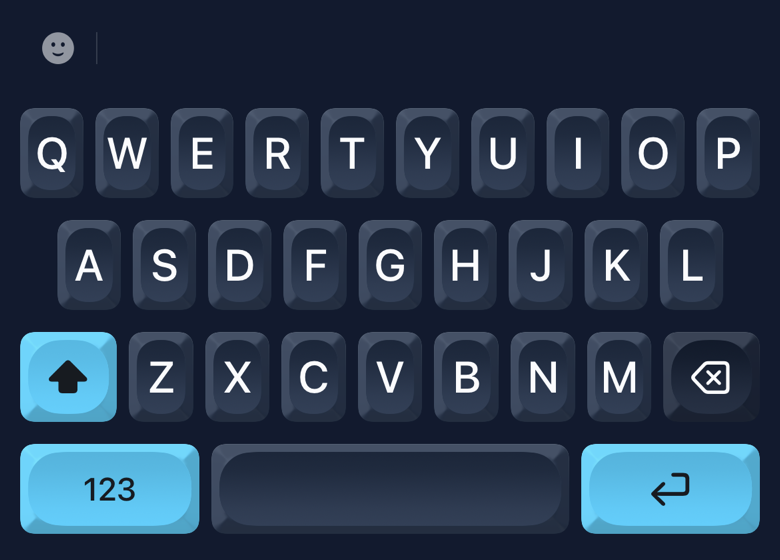</a> |
| <a href="Themes/epomaker-light.clinktheme"><strong>Epomaker Light</strong></a><br><a href="README-assets/previews/epomaker-light.png">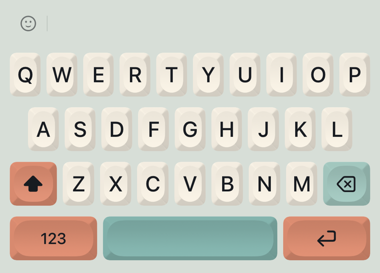</a> | <a href="Themes/epomaker-dark.clinktheme"><strong>Epomaker Dark</strong></a><br><a href="README-assets/previews/epomaker-dark.png">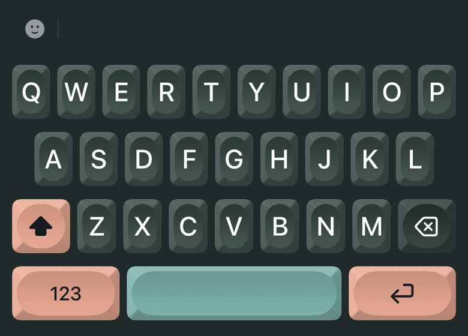</a> |
| <a href="Themes/glorious-light.clinktheme"><strong>Glorious Light</strong></a><br><a href="README-assets/previews/glorious-light.png">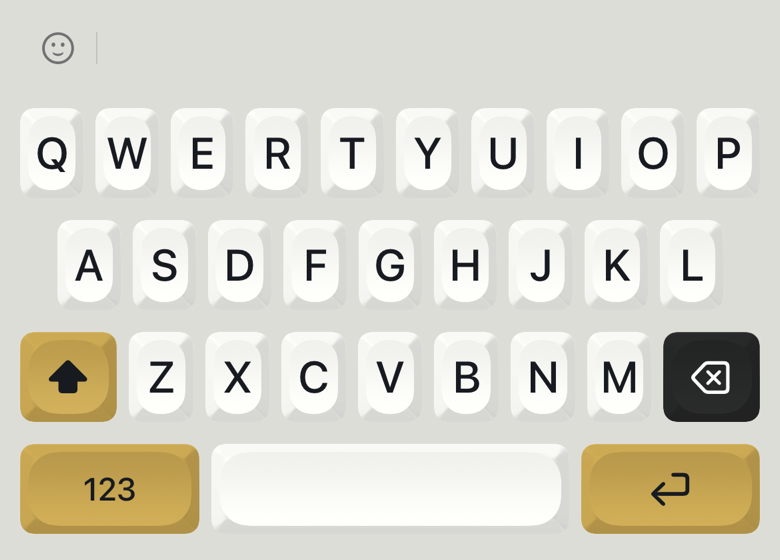</a> | <a href="Themes/glorious-dark.clinktheme"><strong>Glorious Dark</strong></a><br><a href="README-assets/previews/glorious-dark.png">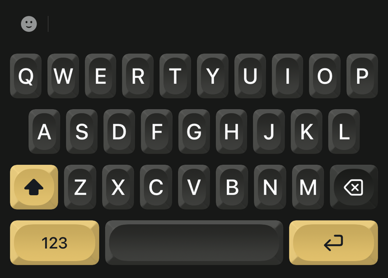</a> |
| <a href="Themes/hhkb-light.clinktheme"><strong>HHKB Light</strong></a><br><a href="README-assets/previews/hhkb-light.png">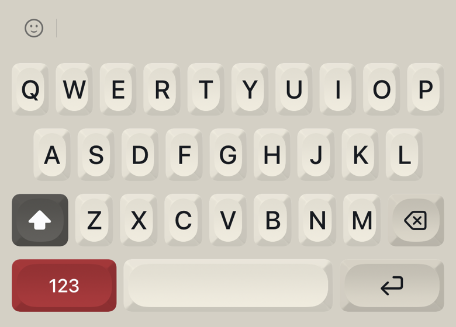</a> | <a href="Themes/hhkb-dark.clinktheme"><strong>HHKB Dark</strong></a><br><a href="README-assets/previews/hhkb-dark.png">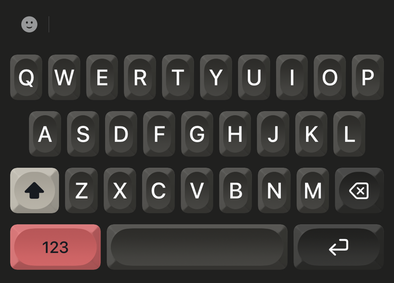</a> |
| <a href="Themes/higround-light.clinktheme"><strong>Higround Light</strong></a><br><a href="README-assets/previews/higround-light.png">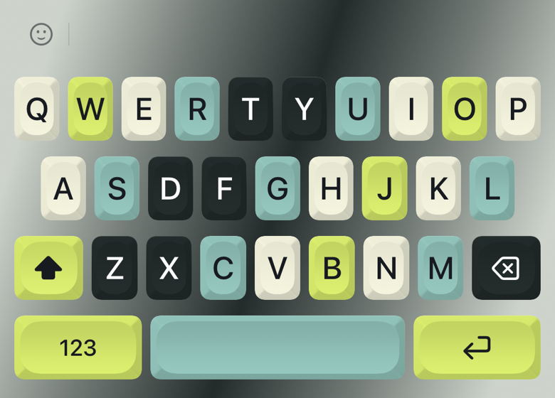</a> | <a href="Themes/higround-dark.clinktheme"><strong>Higround Dark</strong></a><br><a href="README-assets/previews/higround-dark.png">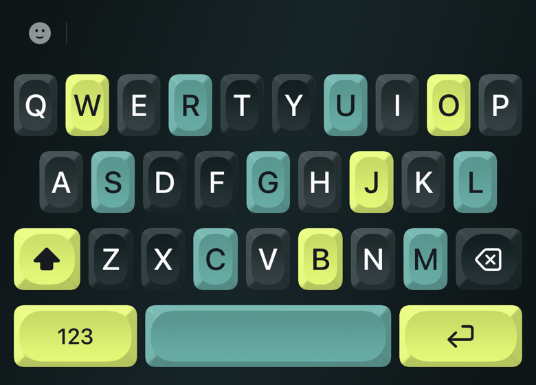</a> |
| <a href="Themes/iqunix-light.clinktheme"><strong>IQUNIX Light</strong></a><br><a href="README-assets/previews/iqunix-light.png">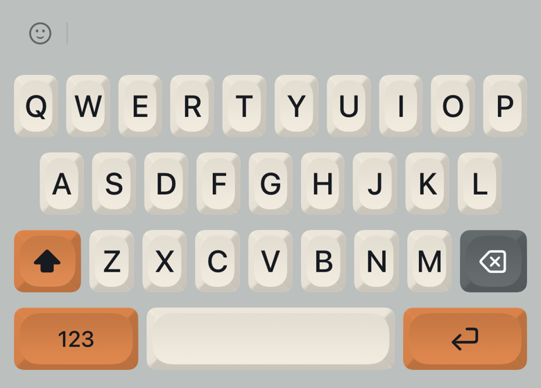</a> | <a href="Themes/iqunix-dark.clinktheme"><strong>IQUNIX Dark</strong></a><br><a href="README-assets/previews/iqunix-dark.png">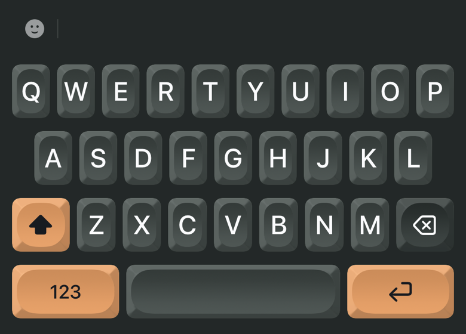</a> |
| <a href="Themes/keychron-light.clinktheme"><strong>Keychron Light</strong></a><br><a href="README-assets/previews/keychron-light.png">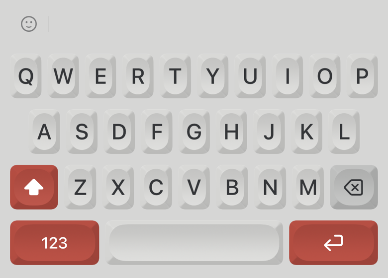</a> | <a href="Themes/keychron-dark.clinktheme"><strong>Keychron Dark</strong></a><br><a href="README-assets/previews/keychron-dark.png">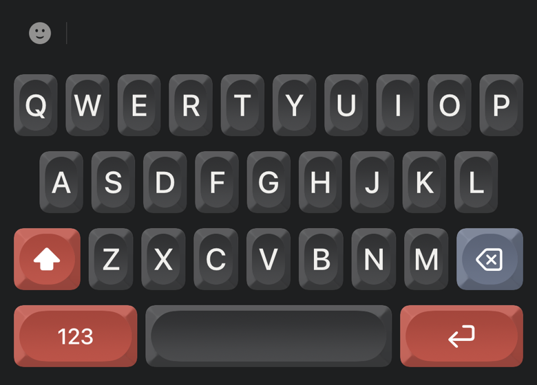</a> |
| <a href="Themes/kiiboom-light.clinktheme"><strong>KiiBOOM Light</strong></a><br><a href="README-assets/previews/kiiboom-light.png">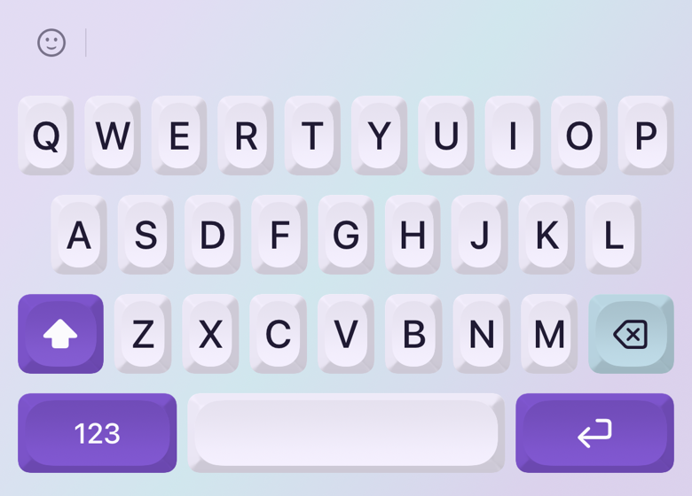</a> | <a href="Themes/kiiboom-dark.clinktheme"><strong>KiiBOOM Dark</strong></a><br><a href="README-assets/previews/kiiboom-dark.png">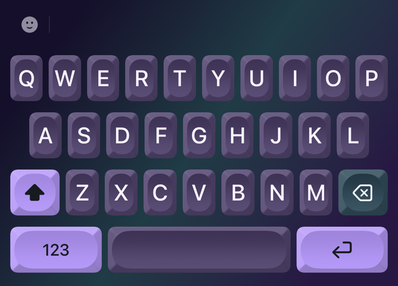</a> |
| <a href="Themes/leopold-light.clinktheme"><strong>Leopold Light</strong></a><br><a href="README-assets/previews/leopold-light.png">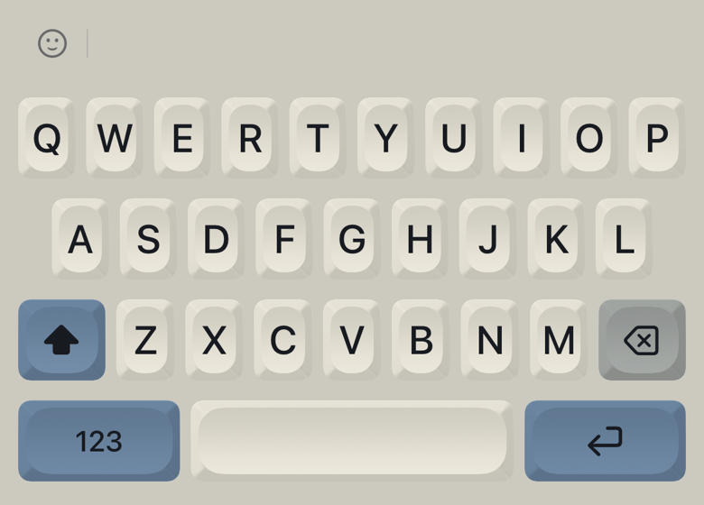</a> | <a href="Themes/leopold-dark.clinktheme"><strong>Leopold Dark</strong></a><br><a href="README-assets/previews/leopold-dark.png">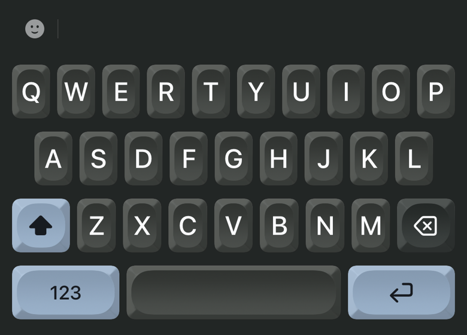</a> |
| <a href="Themes/lofree-light.clinktheme"><strong>Lofree Light</strong></a><br><a href="README-assets/previews/lofree-light.png">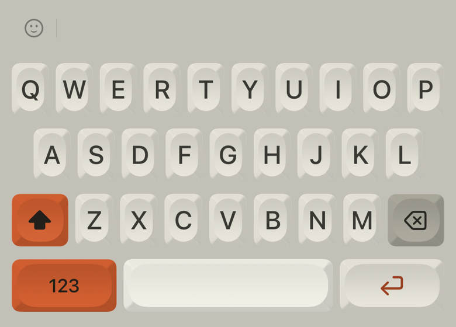</a> | <a href="Themes/lofree-dark.clinktheme"><strong>Lofree Dark</strong></a><br><a href="README-assets/previews/lofree-dark.png">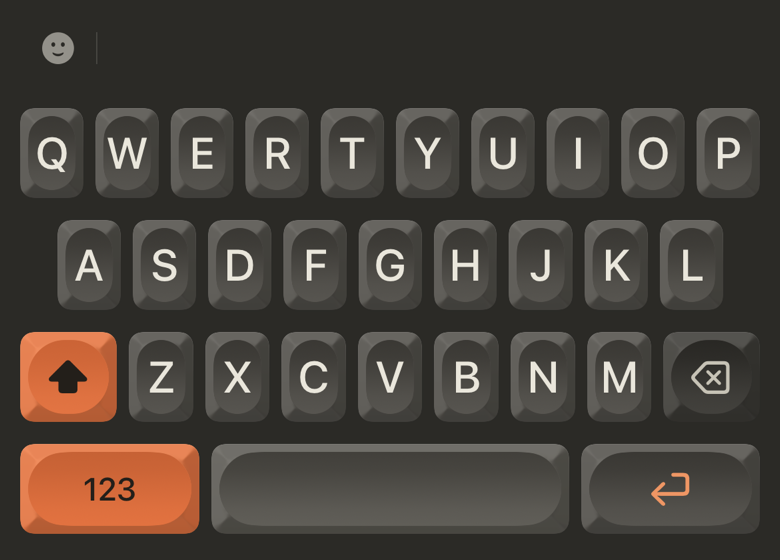</a> |
| <a href="Themes/logitech-g-light.clinktheme"><strong>Logitech G Light</strong></a><br><a href="README-assets/previews/logitech-g-light.png">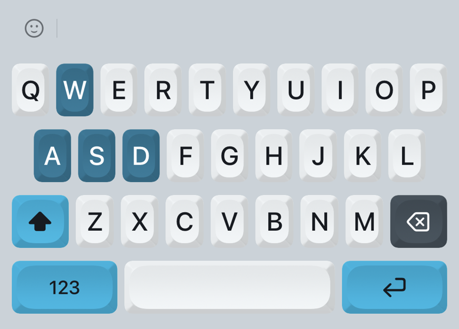</a> | <a href="Themes/logitech-g-dark.clinktheme"><strong>Logitech G Dark</strong></a><br><a href="README-assets/previews/logitech-g-dark.png">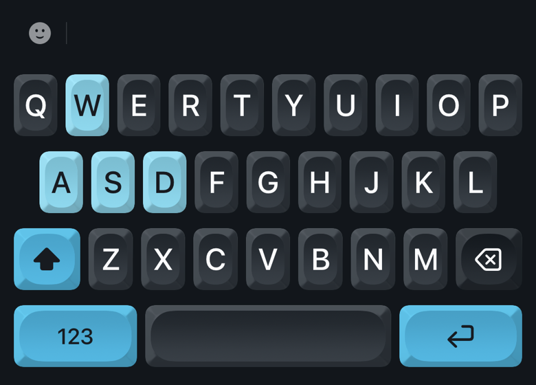</a> |
| <a href="Themes/melgeek-light.clinktheme"><strong>MelGeek Light</strong></a><br><a href="README-assets/previews/melgeek-light.png">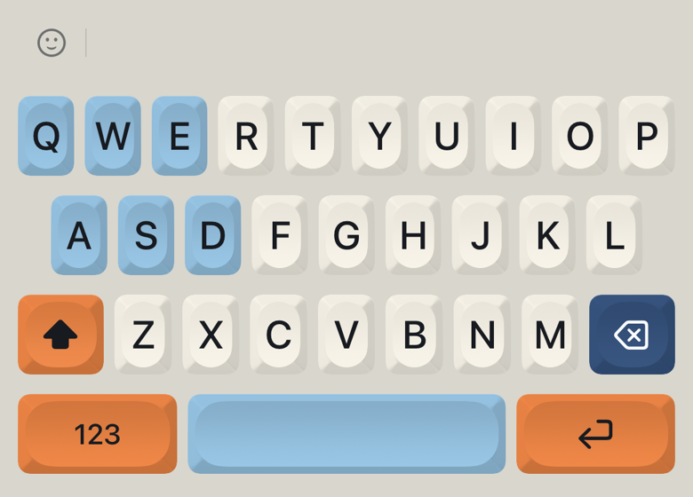</a> | <a href="Themes/melgeek-dark.clinktheme"><strong>MelGeek Dark</strong></a><br><a href="README-assets/previews/melgeek-dark.png">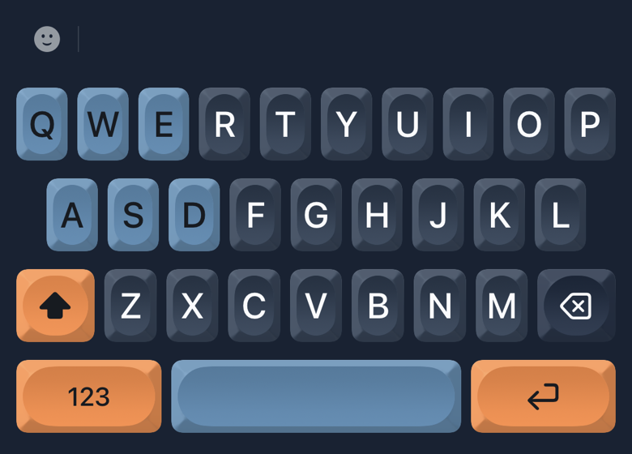</a> |
| <a href="Themes/mode-light.clinktheme"><strong>Mode Light</strong></a><br><a href="README-assets/previews/mode-light.png">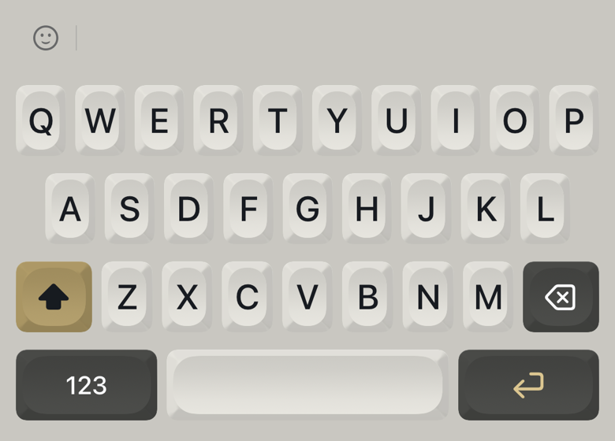</a> | <a href="Themes/mode-dark.clinktheme"><strong>Mode Dark</strong></a><br><a href="README-assets/previews/mode-dark.png">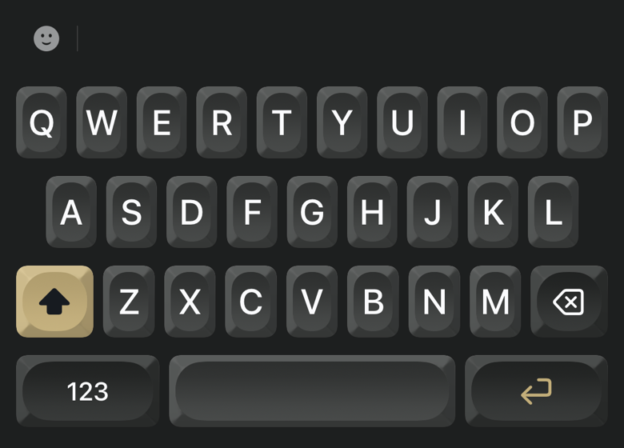</a> |
| <a href="Themes/monsgeek-light.clinktheme"><strong>MonsGeek Light</strong></a><br><a href="README-assets/previews/monsgeek-light.png">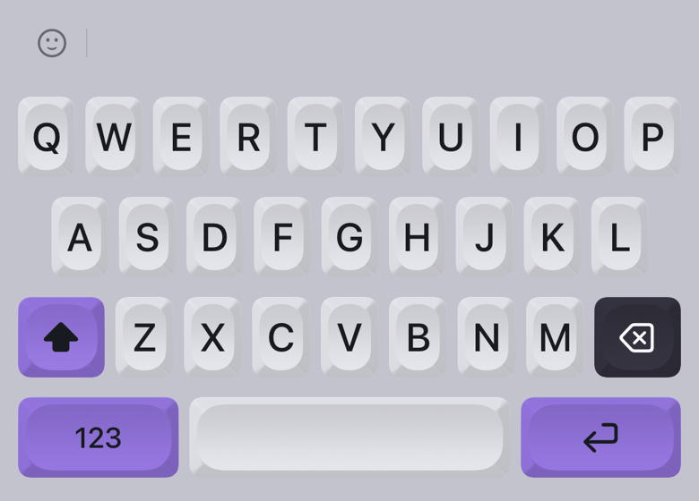</a> | <a href="Themes/monsgeek-dark.clinktheme"><strong>MonsGeek Dark</strong></a><br><a href="README-assets/previews/monsgeek-dark.png">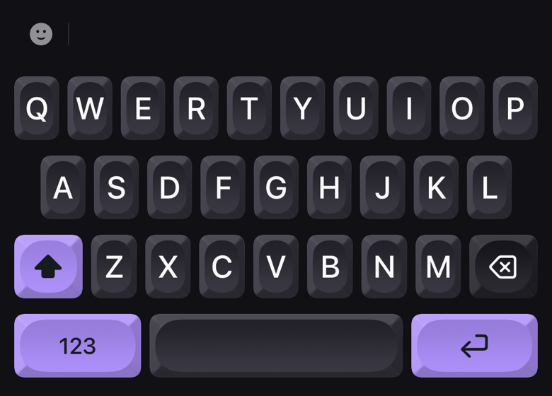</a> |
| <a href="Themes/niz-light.clinktheme"><strong>NIZ Light</strong></a><br><a href="README-assets/previews/niz-light.png">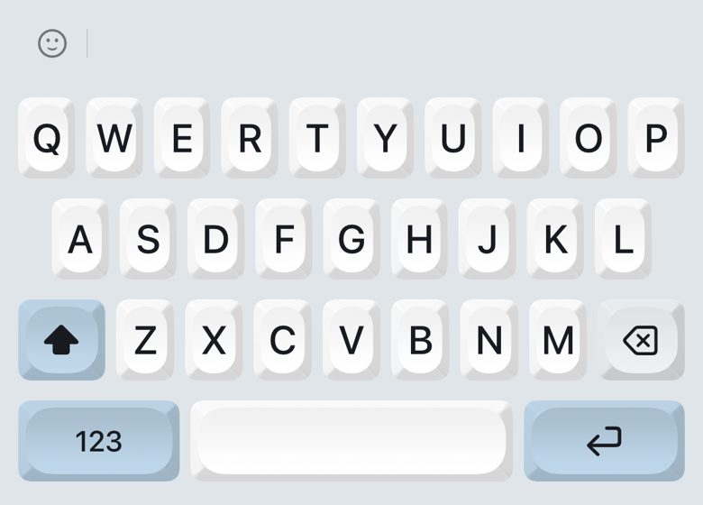</a> | <a href="Themes/niz-dark.clinktheme"><strong>NIZ Dark</strong></a><br><a href="README-assets/previews/niz-dark.png">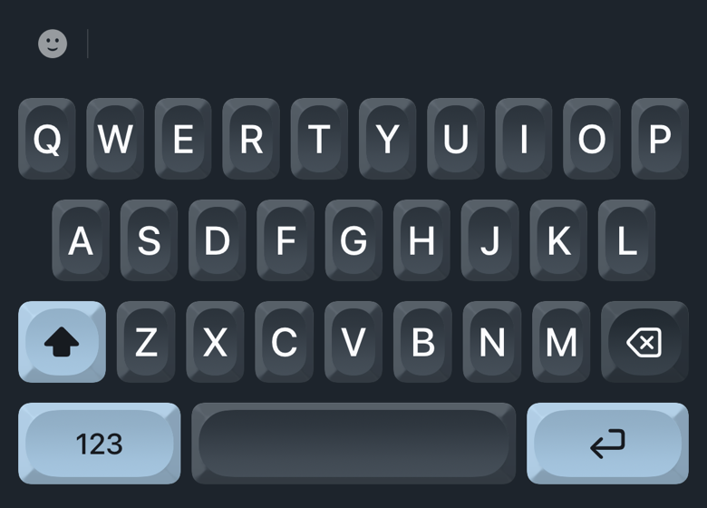</a> |
| <a href="Themes/novelkeys-light.clinktheme"><strong>NovelKeys Light</strong></a><br><a href="README-assets/previews/novelkeys-light.png">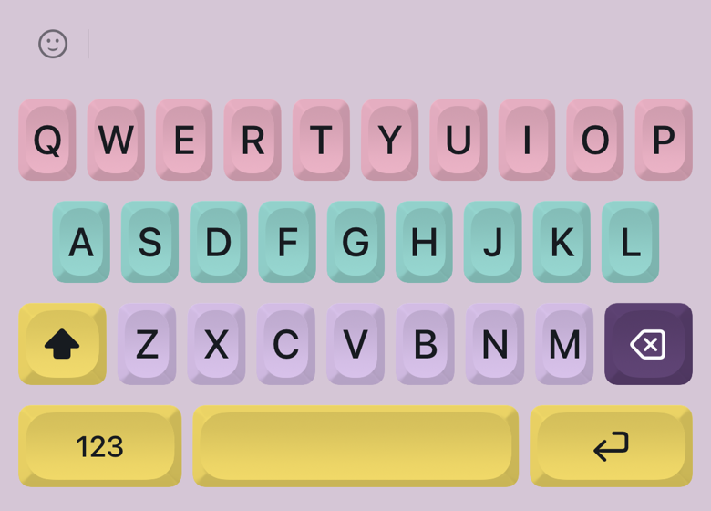</a> | <a href="Themes/novelkeys-dark.clinktheme"><strong>NovelKeys Dark</strong></a><br><a href="README-assets/previews/novelkeys-dark.png">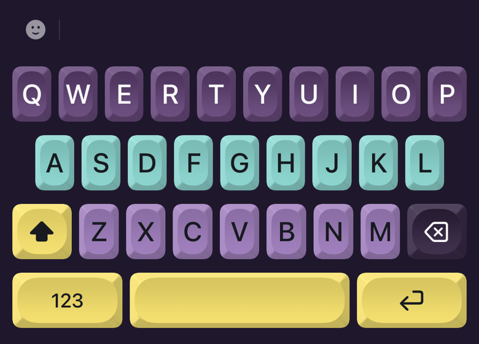</a> |
| <a href="Themes/nuphy-light.clinktheme"><strong>NuPhy Light</strong></a><br><a href="README-assets/previews/nuphy-light.png">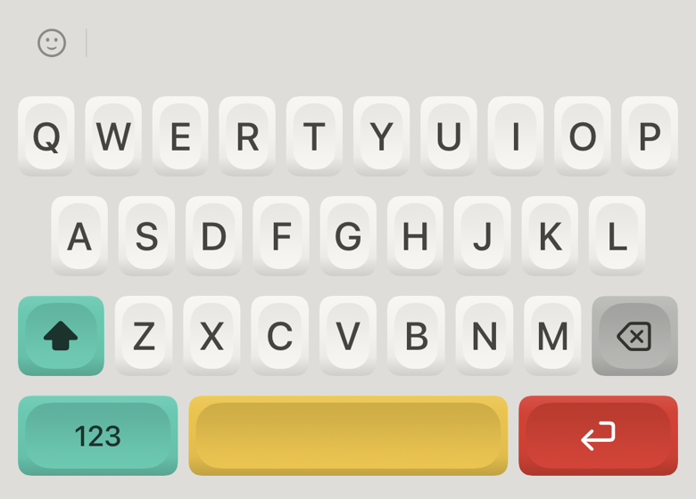</a> | <a href="Themes/nuphy-dark.clinktheme"><strong>NuPhy Dark</strong></a><br><a href="README-assets/previews/nuphy-dark.png">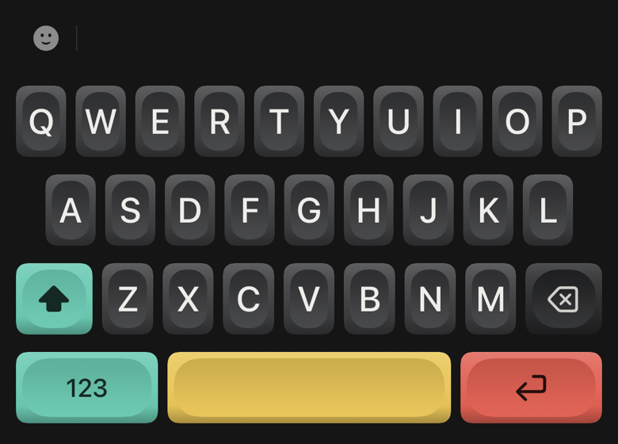</a> |
| <a href="Themes/qwertykeys-light.clinktheme"><strong>Qwertykeys Light</strong></a><br><a href="README-assets/previews/qwertykeys-light.png">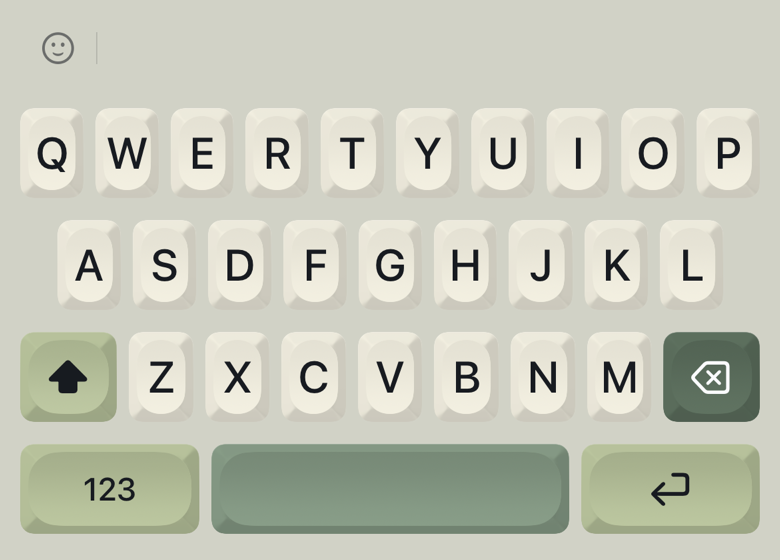</a> | <a href="Themes/qwertykeys-dark.clinktheme"><strong>Qwertykeys Dark</strong></a><br><a href="README-assets/previews/qwertykeys-dark.png">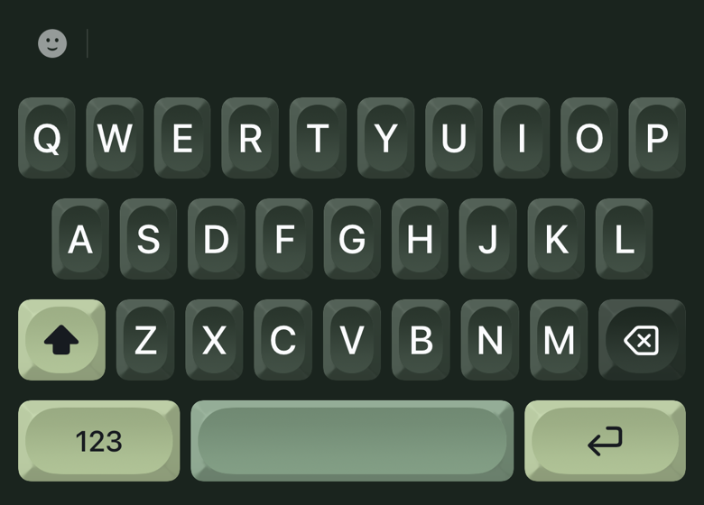</a> |
| <a href="Themes/razer-light.clinktheme"><strong>Razer Light</strong></a><br><a href="README-assets/previews/razer-light.png">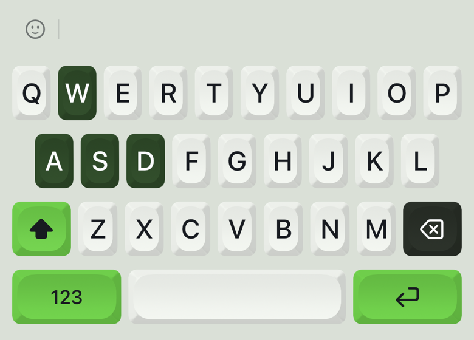</a> | <a href="Themes/razer-dark.clinktheme"><strong>Razer Dark</strong></a><br><a href="README-assets/previews/razer-dark.png"></a> |
| <a href="Themes/rog-light.clinktheme"><strong>ROG Light</strong></a><br><a href="README-assets/previews/rog-light.png"></a> | <a href="Themes/rog-dark.clinktheme"><strong>ROG Dark</strong></a><br><a href="README-assets/previews/rog-dark.png"></a> |
| <a href="Themes/steelseries-light.clinktheme"><strong>SteelSeries Light</strong></a><br><a href="README-assets/previews/steelseries-light.png"></a> | <a href="Themes/steelseries-dark.clinktheme"><strong>SteelSeries Dark</strong></a><br><a href="README-assets/previews/steelseries-dark.png"></a> |
| <a href="Themes/varmilo-light.clinktheme"><strong>Varmilo Light</strong></a><br><a href="README-assets/previews/varmilo-light.png"></a> | <a href="Themes/varmilo-dark.clinktheme"><strong>Varmilo Dark</strong></a><br><a href="README-assets/previews/varmilo-dark.png"></a> |
| <a href="Themes/wooting-light.clinktheme"><strong>Wooting Light</strong></a><br><a href="README-assets/previews/wooting-light.png"></a> | <a href="Themes/wooting-dark.clinktheme"><strong>Wooting Dark</strong></a><br><a href="README-assets/previews/wooting-dark.png"></a> |

The complete collection is published under [`Themes/`](Themes). The generated [`manifest.json`](manifest.json) describes every release asset.

<!-- theme-gallery:end -->

## Make your first theme

You do not need to build Clink or write a manifest.

1. Fork this repository.
2. In Clink, make a theme and choose **Export** from the theme menu. This gives you a `.clinktheme` file.
3. Put the file in [`Themes/`](Themes), for example `Themes/my-theme.clinktheme`.
4. Open the file in a text editor. Give it a permanent lowercase `id` and a clear visible `name`.
5. Do not include `backgroundImageID` or `keyImageID`. Repository themes can contain colours, gradients, materials, and fonts, but not image files.
6. Run these commands:

   ```sh
   python3 tools/build-manifest.py
   python3 -m json.tool manifest.json >/dev/null
   ```

7. Push to `main`. GitHub Actions publishes a versioned release and marks it as the latest release.

## Add your repository to Clink

Open **General → Repositories** in Clink and add `owner/repository`, for example:

```text
anti-ltd/clink-themes-unofficial
```

Then open **Customize → Look**, choose your repository's chip, and download a theme. Downloaded themes remain available offline. They stay read-only, but anyone can make an editable copy.

## Make a theme with an AI agent

This repository includes [`PROMPT.md`](PROMPT.md), a ready-to-use brief for an AI coding agent. Fork the repository, open the fork in your agent, and say:

```text
Read PROMPT.md and create a [describe the visual direction] theme.
```

The prompt tells the agent which existing themes to inspect, which fields are safe to use, and how to regenerate the manifest. Review the resulting JSON and import it into Clink before publishing.

## What Clink verifies

Clink accepts only public HTTPS GitHub release manifests. Each theme must come from that repository's release, be a `.clinktheme` JSON file no larger than 128 KB, and match the SHA-256 hash and byte count in the manifest.

Clink downloads each file into a temporary directory, verifies its checksum and safe data-only structure, and only then installs it. Themes cannot contain photos or executable code.

Adding a repository is a trust decision. Only add repositories whose release contents you trust.

## Publishing is automatic

Keep `Themes/`, `tools/`, `tests/`, and `.github/workflows/` in your fork. Add or update a theme, regenerate the manifest, and push to `main`. GitHub Actions runs the manifest tests, builds the manifest, and publishes a versioned release so Clink can download the themes.

Release tags are derived from the theme files' contents. Each manifest points to
the exact version it describes; published assets and previous releases are kept.
This prevents cached previews or manifests from downloading replacement files
with different checksums. Clink still discovers updates through GitHub's
`releases/latest/download/manifest.json` address. Do not delete older releases,
including the original `latest` tag, while clients may still have their manifests.

Local manifest builds default to `anti-ltd/clink-themes-unofficial`. For a fork, set `GITHUB_REPOSITORY=owner/repository` when running the builder. GitHub Actions uses the actual repository name automatically.

## Refresh the previews

Run `ThemeRepositoryGalleryTests` in the Clink app's simulator test host and export its xcresult attachments, then run:

```sh
python3 -m pip install Pillow
python3 tools/update-readme-gallery.py /path/to/exported-attachments
```

The gallery uses Clink's production keyboard renderer. [`README-assets/preview-manifest.json`](README-assets/preview-manifest.json) records the theme and preview checksums for each capture.
